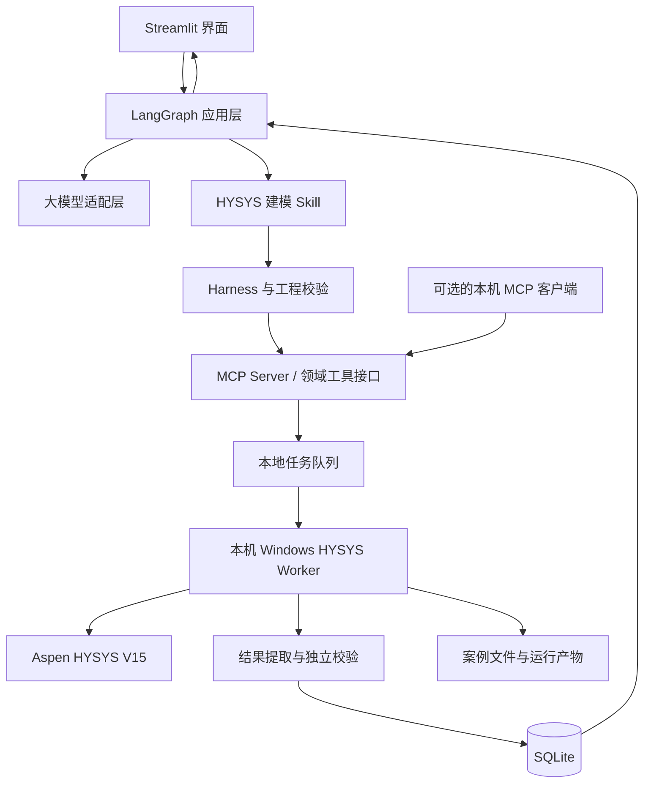

# 化工反应器建模 Agent 实施规划

## 1. 项目目标

构建一个基于 **LangGraph + Harness + Aspen HYSYS V15** 的化工反应器建模系统。用户以自然语言描述反应和工况，系统将其转换为结构化模型规格，检查信息完整性，提出反应器选择和建模计划，经校验后驱动 HYSYS 实际计算，并返回真实结果、校验状态、假设和可追溯的案例文件。

项目从空目录开始，不假定已有代码或技术栈。首个阶段创建 Git 仓库、项目骨架、依赖配置、`.gitignore`、README、测试结构和本地启动脚本。

系统不应只针对两个固定场景编写专用流程。反应器类型必须由大模型根据用户描述中的反应特征、可用参数和领域规则进行判断；不得根据场景名称、固定案例 ID 或硬编码条件直接映射到预设反应器。两个必测场景作为模型判断与端到端能力的评测样例，不作为专用代码分支。Harness 和确定性校验器负责检查模型选择是否满足数据要求、是否可由当前后端执行，并返回冲突或限制；它们不得静默替换模型的判断。通用性通过统一数据协议、领域规则、受约束工具和可扩展的 HYSYS 适配层实现。对缺失数据、不支持的组分或无法自动化的配置，应主动澄清或解释限制，不得编造模拟结果。

## 2. 首版范围与边界

首版目标支持 HYSYS 自动化接口能够实际配置和验证的反应器类型：

- Conversion Reactor
- Equilibrium Reactor
- Gibbs Reactor
- CSTR
- PFR

具体支持范围以目标工作站上的 HYSYS V15 实机能力验证为准，不能仅依据接口名称推定功能可用。系统支持自然语言输入和结构化参数确认；计算结果必须来自 HYSYS 实际运行，并能关联到对应输入版本、运行记录和案例文件。

## 3. 总体架构



职责划分：

- **LangGraph + 大模型**：解析用户需求，并由模型依据反应类型、可用参数、相态和建模规则选择反应器、说明理由；工作流负责暂停补参、调用工具、根据结果分支和有限恢复。场景样例不得走硬编码的反应器映射。
- **HYSYS Skill**：提供化工建模领域的操作指南、输入要求、工具使用顺序、澄清原则和结果解释规则；不直接执行 COM 操作。
- **Harness**：输入与计划校验、工具权限、状态管理、超时、重试、日志、审计和结果验收。
- **MCP Server**：将稳定的领域工具以标准协议暴露给 LangGraph 和其他兼容客户端，隔离调用方与 Worker 的实现细节。
- **HYSYS Worker**：在 Windows 上串行执行模拟器操作，封装 COM 自动化细节。
- **工程校验层**：确定性地检查反应式、单位、物料衡算、组成、转化率和结果有效性。
- **Streamlit 界面**：管理输入、用户补参与确认、运行进度和结果展示；通过应用服务调用 LangGraph，不承载模拟器逻辑。

大模型不得直接访问任意 COM 对象或执行任意脚本。所有对 HYSYS 的写操作都通过 MCP 暴露的有限、类型明确、可记录的领域工具完成。MCP 是复用接口，不代替 Skill 的领域流程说明，也不代替 Harness 的校验、权限与恢复控制。

## 4. 技术栈建议

| 模块 | 技术 | 职责 |
|---|---|---|
| 前端 | Streamlit | Python 单栈实现对话、参数确认、任务进度、结果和历史记录 |
| 图表 | Plotly、Streamlit 图表组件 | 组成对比、工况比较和参数扫描结果 |
| 应用层 | Python 应用服务 | 连接 Streamlit、LangGraph、Harness 和 MCP Client |
| Agent 编排 | LangGraph | 工作流状态、分支、暂停、恢复和工具调用 |
| Agent 能力说明 | 版本化 HYSYS 建模 Skill | 提供可复用的建模步骤、澄清规则、工具调用约束和结果解释指南 |
| 跨客户端工具协议 | MCP Server（Python MCP SDK） | 向 LangGraph 和其他 MCP 客户端暴露稳定领域工具 |
| 模型接入 | DeepSeek OpenAI 兼容 API + LangChain 模型适配层 | 默认使用 DeepSeek；模型 ID、API 地址和密钥由环境配置，保留替换能力 |
| 数据协议 | Pydantic、JSON Schema | 严格定义输入、工具参数和输出 |
| HYSYS 自动化 | Windows、Python、pywin32/COM | 创建案例、配置物流与反应器、求解和读数 |
| 工程计算 | NumPy、SciPy、Pint | 单位处理、衡算和数值校验 |
| 业务数据 | SQLite、SQLAlchemy | 本地任务、输入版本、状态、结果与审计数据 |
| 文件存储 | 工作站本地目录 | HYSYS 案例、日志、导出文件和报告 |
| 可观测性 | 结构化本地日志；可选 OpenTelemetry/Langfuse | 调用链、耗时、错误和模型调用追踪 |
| 测试 | pytest、Hypothesis、Streamlit AppTest | 单元、性质、集成及界面流程测试 |
| 本地启动 | Python 虚拟环境 + PowerShell 启动脚本 | 在工作站本地启动 Streamlit、MCP Server 和 Worker |

系统只面向安装了 HYSYS V15 的 Windows 工作站本地运行，不建设云端或远程部署环境。Streamlit 与 LangGraph 应用层运行在本地 Python 环境；MCP Server 和 HYSYS Worker 作为本机进程启动，Worker 连接本机 HYSYS。为让多个本机 MCP 客户端复用同一个服务，首选 Streamable HTTP 传输并仅绑定 `127.0.0.1`；不对局域网或公网开放。由于 MCP Server 和 Worker 是独立进程，跨进程任务协调统一使用 SQLite 任务表；不使用仅存在于某个进程内存的队列，也不引入 Redis、Celery、PostgreSQL、Docker 或 Kubernetes。SQLite 启用 WAL 和合理的 busy timeout，数据库事务只用于短时间读写，不能在 HYSYS 求解期间保持打开。HYSYS 会话内的修改和求解保持串行。若未来需要 REST 客户端，再增加 FastAPI 适配层，不纳入首版必需组件。

### 4.1 Skill、MCP 与 Worker 的复用边界

- **Skill 可复用**：同一份版本化 Skill 可被不同 Agent 流程加载，指导它们收集建模信息、处理缺参、按顺序调用工具及解释结果。Skill 本身是领域说明和工作流程，不等同于可执行的 HYSYS 接口。
- **MCP 可复用**：同一个 MCP Server 可供本项目 LangGraph、其他 MCP 客户端或未来的自动化流程调用，提供稳定且有 Schema 的领域工具。
- **Worker/Adapter 可替换**：MCP 工具调用内部稳定的领域接口；底层可替换 COM Adapter、增加 UI 自动化 Adapter，或增加其他模拟器后端，而上层 Skill 和工作流尽量不变。
- **能力需声明**：各后端应提供能力清单，包括支持的反应器、物性包、属性读写、案例保存和结果读取能力。调用前检查能力，不支持时明确拒绝或提出替代路径。
- **结果不承诺跨模拟器相同**：热力学方法、物性模型和反应器实现差异需要在后端能力和运行记录中披露。

建议的稳定领域工具包括 `inspect_simulator`、`validate_model`、`create_case`、`configure_feed`、`configure_reaction`、`configure_reactor`、`solve_case`、`get_results` 和 `save_case`。工具输入输出使用统一数据协议；模拟器专属选项置于明确命名的扩展字段中，避免把 HYSYS 内部对象模型泄露给所有调用方。

### 4.2 DeepSeek API 配置

通过项目根目录的 `.env` 或工作站系统环境变量配置模型连接，不把密钥写入代码、Skill、日志或 Git。示例：

```env
DEEPSEEK_API_KEY=替换为个人密钥
DEEPSEEK_BASE_URL=https://api.deepseek.com
DEEPSEEK_MODEL=以 DeepSeek 控制台公布的准确模型 ID 为准
```

DeepSeek API 地址、模型 ID 和模型能力以 DeepSeek 官方控制台/API 文档为准；应确认用户指定的 V4.1 Flash 型号是否已开放 API 及其准确 ID。启动时执行连通性和最小工具调用测试，不要仅因模型能返回文本，就认定它支持 LangGraph 所需的工具调用或结构化输出。模型调用失败、限流或不支持工具调用时，应向用户报告可理解的错误，不得绕过 Harness 直接执行工具。`.env` 必须加入 `.gitignore`，日志不得记录 API 密钥。

## 5. 核心数据协议

定义统一的 `ReactorModelSpec`。自然语言、前端表单和未来的数据导入都转换为该协议；HYSYS 适配层只接受通过校验的协议。

协议至少包含：

- **FeedStream**：组分及 HYSYS 标识、组成及基准、流量、温度、压力和单位。
- **ReactionSpec**：反应物/产物、计量系数、反应相态、基准组分。
- **ReactorSpec**：反应器类型、操作条件、设备参数和可用模型参数。
- **ThermoSpec**：物性方法、所需数据及选择依据。
- **KnownParameters**：转化率、选择性、平衡数据、动力学参数或其他工艺指标。
- **Assumptions**：系统提出且用户确认的建模假设及其影响。
- **MissingInformation**：缺失字段、对模型的影响和需要用户回答的问题。
- **SimulationRequest/SimulationResult**：任务 ID、输入版本、运行状态、结果、诊断和案例文件引用。

基础类型与字段范围由 Pydantic 校验；元素守恒、单位合理性、参数充分性等化工规则由独立的确定性代码校验。

## 6. LangGraph 工作流

建议以单一主图起步，按职责拆分节点；只有确有并行或边界清晰的子任务时再增加子图或子 Agent。

```text
START
  -> parse_request
  -> validate_spec
      -> 信息不足/冲突：ask_user -> 等待答复并恢复
  -> select_reactor
  -> build_plan
  -> harness_gate
  -> run_hysys
  -> validate_result
      -> 可恢复故障：diagnose_and_retry（有限次数）
      -> 工程校验失败：返回诊断或请求补充
  -> explain_result
  -> END
```

LangGraph 状态应保存结构化需求、用户补充、当前计划、任务 ID、案例位置、工具输入输出、错误分类、重试次数和运行阶段。Checkpoint 只能恢复工作流状态；HYSYS 内部状态需通过已保存案例恢复，或根据完整规格重新建模。

任务数据和 LangGraph checkpoint 都采用 SQLite 持久化；首版应统一使用一个数据库文件或明确区分两个文件，并配置备份/迁移策略，避免只保存任务记录却丢失图状态。

### 6.1 多轮对话与任务记忆

支持任务内多轮补充和修改，但记忆应有边界并以结构化数据为准：

- **会话状态**：当前运行阶段、待用户回答的问题和 LangGraph checkpoint，用于暂停后恢复。
- **任务规格**：已确认的进料、反应、操作条件、假设和来源，持久化为带版本的 `ReactorModelSpec`。
- **运行记录**：每次 HYSYS 案例、工具调用摘要、结果、校验状态和文件引用，关联到对应规格版本。
- 当前任务内可以复用已确认的信息；系统推断的参数必须标为假设，未经用户确认不得升级为已确认事实。
- 用户修改已确认参数时创建新规格版本，旧版本与其模拟结果保持可追溯。
- 新建任务默认不继承旧任务的工程参数；只有用户明确选择沿用时才复制，并在新任务记录来源。
- 聊天记录不能代替规格、案例文件和运行记录；历史自然语言仅用于上下文，不作为唯一数据源。

Agent 可以决定何时澄清、如何解释选择、遇到诊断后采取哪种允许的恢复路线；不得越过 Harness 直接写入 HYSYS，也不得把未经确认的假设当作用户输入。

## 7. Harness 与 HYSYS Worker

### 7.1 MCP 领域工具接口

MCP Server 提供有限、可复用的领域工具：

```text
list_backend_capabilities
inspect_simulator
validate_model
create_case
configure_feed
configure_reaction
configure_reactor
solve_case
get_results
save_case
```

每个工具都应有输入输出 Schema、调用 ID、前置条件、超时、错误分类和结构化日志。具有副作用的操作应记录规格版本，并在关键步骤保存检查点。MCP 工具定义保持领域化、后端无关；能力查询返回当前模拟器/Adapter 支持的功能。

### 7.2 Worker 运行规则

- 工作站启动时探测 HYSYS 版本、可用组分、物性方法和自动化能力。
- 每个任务基于独立案例副本运行，不修改基础模板或其他任务案例。
- 单个 HYSYS 会话内串行操作，避免并发写入同一案例。
- 将 COM 初始化和 HYSYS 调用固定在 Worker 的专用 STA 线程/进程中，不跨线程传递 COM 对象。
- 设置连接超时、求解超时、进程健康检查和有限重试。
- 失败时保存可供诊断的案例状态和日志；恢复时核对案例与任务输入版本。
- 如 COM 无法覆盖某项操作，只为该明确缺口增加 UI 自动化适配器，并与业务工具接口隔离。
- Worker 只实现内部执行协议，不要求 Agent 或 Skill 了解 Windows 进程、COM 对象路径和 HYSYS 专属属性细节。

### 7.3 错误分类

- 输入无效或关键参数缺失。
- 组分、物性方法或反应器配置不支持。
- HYSYS 连接失败或进程异常。
- 对象创建/属性配置失败。
- 求解超时或未收敛。
- 结果读取失败或结果缺失。
- 衡算、组成或目标转化率校验失败。

错误分类决定是否澄清、重试、重建案例或停止；不能对所有错误都盲目重试。

## 8. 工程校验与结果可信度

校验器必须独立于大模型。大模型可以解释诊断，但不能覆盖校验器的结论。

### 建模前校验

- 反应式元素守恒。
- 组成总和和组成基准正确。
- 流量、温度、压力及单位合法。
- 必需参数存在，单位可转换。
- 反应器选择与已知参数相容。
- 记录大模型选择的反应器类型、选择理由、依据的数据和不确定性；校验发现所需参数不足或后端不支持时，返回诊断给工作流，由模型向用户澄清或说明限制，不静默改选其他类型。
- 物性方法与组分、相态需求相容。

### 求解后校验

- HYSYS 求解状态可接受。
- 关键出口流股及其属性有有效数值。
- 组成范围正确，基准和单位明确。
- 总物料与元素衡算误差在经过验证的阈值内。
- 设定的转化率/选择性与计算结果一致。
- 返回结果对应当前输入版本和当前案例，而非缓存或旧案例。

阈值应按物性方法、数值精度和案例类型配置并验证，不能未经评估就使用单一固定值。

## 9. 分阶段实施计划与验收

### 阶段 1：HYSYS 自动化能力验证

验证 Python 能否连接 HYSYS V15、打开/另存案例、设置组分和物性方法、创建物流、设置温压流量、创建一种反应器、配置反应、求解、读取结果并保存可重新打开的案例。形成 `hysys-capabilities.md`，记录每个对象/属性的读写能力和失败限制。

**验收：** 从干净脚本完成一次真实 HYSYS 计算，读取输出并保存有效案例文件。

### 阶段 2：统一数据协议与领域校验

实现 Pydantic 模型、单位和组成基准约定、反应式解析结果结构、元素守恒、参数完整性及错误诊断。

**验收：** 合法输入通过；非守恒反应、错误单位、非法组成和缺少必要参数均能返回定位清楚的诊断。

### 阶段 3：HYSYS Adapter、MCP Server 与串行 Worker

封装 HYSYS 对象访问，定义后端能力清单和模拟器无关的领域接口；通过 MCP Server 暴露工具；支持独立案例副本、任务领取、超时、求解状态读取、结果提取和错误分类。

**验收：** MCP Inspector 或兼容客户端能发现并调用工具；Worker 可处理任务队列中的案例；故障不会误标成功，其他任务不会共享或污染当前案例；调用方不依赖 COM 对象细节。

### 阶段 4：LangGraph 主图与 Harness

实现并版本化 HYSYS 建模 Skill；LangGraph 通过 MCP 调用领域工具。完成解析、由大模型根据规则进行反应器选型、计划、执行、结果检查、补参暂停和有限恢复。必测场景只作为评测输入，选型过程不得读取场景 ID 或命中案例专属规则。Harness 校验模型选型可执行性，但不替模型作出选型。持久化图状态，并关联规格版本与 HYSYS 案例状态。

**验收：** 能暂停等待用户补充后继续；同一任务正确复用已确认参数；修改参数生成新规格版本；新任务默认不串入历史参数；必测案例及额外反应均通过相同的模型选型链路；修改措辞或工况后，系统依据新输入重新判断而非复用场景映射；服务中断后可恢复或明确说明无法恢复原因；重试次数有上限。

### 阶段 5：本地任务记录和运行进度

实现任务创建、任务状态、补充参数、取消（在模拟器安全边界内）、结果读取和界面进度刷新。使用 SQLite 管理本地任务、跨进程任务队列和运行数据，并为 HYSYS 案例、日志和导出物设置明确的本地数据目录。

**验收：** 长任务在独立 Worker 中运行；Streamlit 能持续查看真实状态，界面刷新或重启后可以重新查询任务状态。

### 阶段 6：Streamlit 操作界面

用 Streamlit 实现自然语言输入、结构化需求预览、缺参问题、假设确认、反应器选择理由、运行阶段、计算结果、工况对比和文件下载。界面通过应用服务调用 LangGraph，不直接连接 HYSYS Worker。将 UI 与领域逻辑分离，未来需要 REST API 时可增加 FastAPI 适配层；需要复杂 Web 交互时再增加 React 界面。

**验收：** 用户能发现并修正解析错误、确认假设、看到运行进度和结果来源；界面不承载 HYSYS 自动化逻辑。

### 阶段 7：本地审计、观测和复现

在本地数据库和运行目录保存原始输入、结构化规格版本、用户确认、工具调用摘要、HYSYS 版本、物性方法、求解状态、结果校验、案例文件引用和运行时间。为 Streamlit 会话、Agent、MCP Server 和 Worker 建立关联 Trace ID。

**验收：** 给定一次历史任务，可还原其建模输入、假设、工具步骤、结果与 HYSYS 案例。

### 阶段 8：系统测试和演示准备

完成单元、集成、HYSYS 实机和端到端测试；编写本地环境准备、启动/关闭说明、架构说明、能力边界和现场演示步骤。为用户准备两个必测场景的录屏流程、演示顺序和检查清单；视频由用户自行录制，Agent 不负责录制或生成视频。

**验收：** 正常案例、缺参案例、非支持案例、HYSYS 故障案例均有明确且符合预期的行为；用户可以依照演示清单完成录屏。

## 10. 必测及扩展验收场景

1. **甲苯歧化**：按题目给定的 50% 转化率进行计算；确认基准组分、进料组成和单位。
2. **甲烷蒸汽重整**：对 710°C 与 600°C 两个出口条件分别运行并比较结果；清楚说明采用的平衡/反应器模型、物性方法和假设。
3. **异构体缺参**：甲苯歧化反应式只能确定二甲苯总量，不能单独推出邻/间/对二甲苯比例。系统应要求选择性数据或经用户确认一个假设，并在结果中披露。
4. **其他参数完整反应**：使用统一协议走通新的反应和可用的反应器配置，证明流程不是固定场景脚本。
5. **动力学或平衡数据不足**：明确指出当前缺少什么数据、影响哪个模型，并暂停或说明可采用的模型边界。
6. **求解失败/连接异常**：返回真实失败状态、阶段和诊断；不输出伪造的成功结果。
7. **结果复现**：历史任务可关联到输入版本、运行日志和可打开的 HYSYS 案例。

## 11. 考核交付物与用户录屏

最终交付应覆盖原始考核文件中的全部要求：

- **代码仓库**：从空目录建立 Git 仓库，包含完整源码、README、本地环境配置说明、支持范围和运行方法；按考核要求准备 GitHub 仓库，并检查提交历史可体现独立开发过程。
- **运行录屏**：由用户自行录制两个必测场景从输入到 HYSYS 返回结果的完整过程。项目提供录屏步骤、演示顺序、画面检查清单和故障备用方案，不要求 Agent 录制视频。
- **AI 开发记录**：保留并导出本次开发中使用的 AI 编程助手 session 记录或截图，按考核要求整理。
- **技术报告**：准备 1–2 页，覆盖技术选型、系统架构、探索过程、遇到的问题和解决方式。
- **Live Demo**：准备启动/关闭步骤、必测场景演示顺序、额外通用反应验证和现场问答要点。

**验收：** 代码和本地运行说明齐全；两个必测案例能现场运行；录屏指南可直接照做；AI 开发记录与技术报告有明确待办和保存位置。

## 12. 推荐仓库结构

```text
reactor-agent/
├── apps/
│   └── ui/                  # Streamlit 界面与本地应用入口
├── services/
│   ├── mcp-server/           # MCP 领域工具服务
│   └── hysys-worker/         # 本机 Windows 模拟器执行服务
├── packages/
│   ├── domain/              # Pydantic 协议和领域类型
│   ├── engineering/         # 反应式、单位、衡算和结果校验
│   ├── agent/               # LangGraph 工作流与节点
│   ├── skills/               # 版本化的 HYSYS 建模 Skill
│   └── simulator_adapters/  # HYSYS COM/UI 与未来模拟器适配器
├── tests/
│   ├── unit/
│   ├── integration/
│   ├── hysys/
│   └── e2e/
├── docs/
│   ├── architecture.md
│   ├── hysys-capabilities.md
│   └── demo-runbook.md
├── data/                     # 本地 SQLite、案例和运行产物（加入 gitignore）
├── scripts/
│   ├── setup.ps1             # 创建环境并安装依赖
│   └── start.ps1             # 本地启动所需进程
└── pyproject.toml
```

`data/` 中的数据库、HYSYS 案例和运行产物不提交到代码仓库。启动脚本应检查 Python 版本、依赖、HYSYS 安装与配置，并以便于查看日志和关闭的方式启动本地进程。

## 13. 主要风险与应对

| 风险 | 应对 |
|---|---|
| COM 自动化覆盖不足或行为不稳定 | 先做能力探测；记录可读写属性；只对确认缺失的操作补充 UI 自动化 |
| 反应数据不完整 | 主动询问或停止；假设需用户确认并留痕，不生成伪造参数 |
| 反应器模型选择存在多个合理选项 | 返回选择理由、所需数据和替代模型；让用户确认关键建模决策 |
| HYSYS 求解失败或长时间无响应 | 超时、进程健康检查、保存检查点、错误分类和有限重试 |
| Agent 计划不符合工程约束 | 计划必须转换成协议并通过 Harness Gate 后才可执行 |
| 结果合理但不守恒 | 独立做物料/元素衡算；校验失败时禁止标记任务成功 |
| 工作流状态与模拟器状态不一致 | 保存案例检查点并核对输入版本；必要时从规格重新构建案例 |

## 14. 完成定义

一个未写死在程序中的反应需求，经过系统处理后应满足以下条件：

1. 系统能解析出结构化反应与操作条件，或指出准确的缺失/冲突信息。
2. 系统能给出可解释的反应器选择和建模计划。
3. 执行计划通过 Harness 校验后，HYSYS Worker 能实际创建和运行案例。
4. 系统返回真实计算结果、求解状态、工程校验结论和适用假设。
5. 输入、工具步骤、结果和案例文件可追溯，任务中断时能恢复或明确诊断。

只有全部满足时，任务才可标记为成功。

## 15. 建议实施顺序

1. 验证 HYSYS V15 COM 自动化并完成一个最小真实案例。
2. 定义 `ReactorModelSpec`、版本规则和独立工程校验器。
3. 实现模拟器领域接口、能力清单、HYSYS Adapter 与串行 Worker。
4. 实现 MCP Server，验证外部兼容客户端能够发现并调用领域工具。
5. 验证 DeepSeek 配置、API 连通性、结构化输出和最小工具调用。
6. 编写并版本化 HYSYS 建模 Skill，记录工具使用和澄清规则。
7. 实现 LangGraph 主图、MCP 调用、任务内记忆、补参暂停、checkpoint 和有限恢复。
8. 实现结果提取、物料/元素衡算和结果验收。
9. 实现 SQLite 本地任务记录、跨进程队列和运行进度查询。
10. 实现 Streamlit 操作界面、历史记录和结果导出；保持应用服务与领域层边界稳定，便于未来增加 REST API 或 React 界面。
11. 完成本地启动/关闭脚本、依赖检查和数据目录说明。
12. 完成多场景 HYSYS 实机验证、README、技术报告、AI 开发记录整理和 Live Demo 预案；提供由用户自行录制的两个必测场景录屏指南。

最大的前置技术风险是 HYSYS V15 自动化接口的实际能力。因此实施时先完成第一阶段，再据实冻结 Worker 的接口边界和支持清单。
